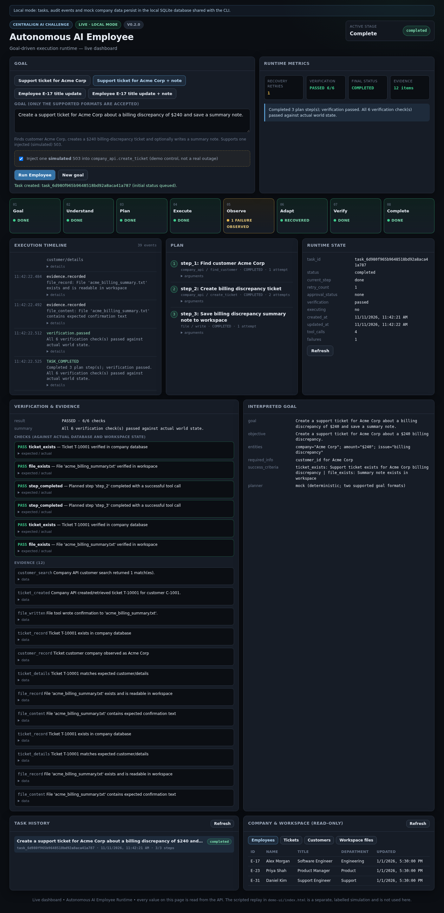
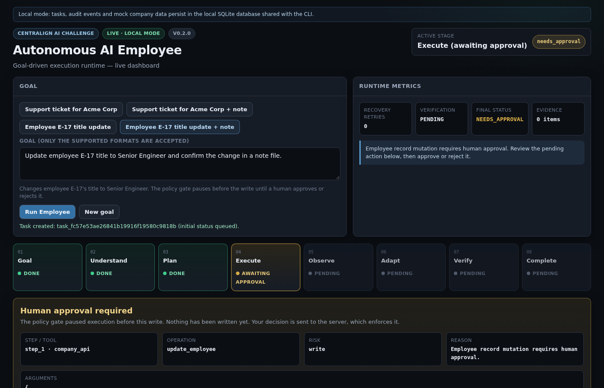
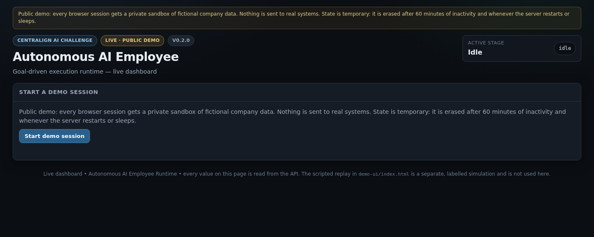

# Autonomous AI Employee Runtime

Prototype runtime for CentrAlign AI's Founding Engineer challenge: an AI worker that
interprets a goal, plans tool calls, executes them against a mock company system,
recovers from transient failures, pauses for human approval before sensitive writes,
and independently verifies the outcome before reporting success.

**Status (v0.2.0):** working prototype, not production software. The planner is a
deterministic mock that accepts exactly two goal formats (below). Tasks can be run from
the CLI or from a live web dashboard backed by an HTTP API; both use the same runtime,
SQLite database and per-task locks. All company data is fictional.



## Contents

- [What v0.2.0 adds](#what-v020-adds)
- [Platform support](#platform-support)
- [Quick start](#quick-start)
- [Supported goals](#supported-goals-mock-planner)
- [Dashboard](#dashboard)
- [CLI walkthrough](#cli-walkthrough)
- [HTTP API](#http-api)
- [Capability registry](#capability-registry)
- [Step-output references](#step-output-references)
- [Goal-scoped plan authorization](#goal-scoped-plan-authorization)
- [Company data model and demo company](#company-data-model-and-demo-company)
- [Local mode and public demo mode](#local-mode-and-public-demo-mode)
- [Security model](#security-model)
- [Configuration](#configuration)
- [Docker](#docker)
- [Deploying the public demo on Render Free](#deploying-the-public-demo-on-render-free)
- [Limitations](#limitations)
- [How it works](#how-it-works)
- [Tests](#tests)

## What v0.2.0 adds

- A **live dashboard** served by FastAPI. It submits real goals, shows the real task ID,
  plan, tool calls, retries, audit events, approval requests and verification evidence,
  and lets you approve, reject or resume tasks. Nothing in it is scripted.
- An **HTTP API** (`/api/v1`) that wraps the existing planner, executor, approval policy,
  verifier and SQLite store. There is no endpoint for arbitrary tools, plans, shell
  commands or file writes.
- **Shared OS locks** between CLI and API processes, so the same task can never be
  executed, approved or rejected by two processes at once.
- Two run modes: **local** (persistent, localhost only) and **public demo** (per-browser
  sandboxes of fictional data on ephemeral storage), plus a Render Free Blueprint.
- Approval events record the approver (`local-dashboard`, `demo-session:<id>`, or
  `cli:<user>`).

### Unreleased (v0.3.0 development)

Safety hardening and an operation-level capability registry. These change no supported
goal, plan or tool; dynamic (LLM-based) planning is **not** part of them.

- `update_employee` rejects unsupported fields, empty updates and non-string or blank
  values with `invalid_args` instead of silently ignoring them; nothing is written.
- Verification fails criteria it cannot evaluate (`unsupported_criterion`), and a task
  with nothing to verify is reported as `unverified` instead of `passed`.
- Approvals are bound to a fingerprint of the exact action; if the action changes, the
  approval is invalidated and a fresh one is requested (`stale_approval`).
- Operation metadata (risk, approval, retry safety, idempotency, verification strategy)
  lives in one registry, discoverable at `GET /api/v1/capabilities`.
- Five new company operations (`list_tickets`, `update_ticket`, `assign_ticket`,
  `create_customer`, `deactivate_employee`) with independent verification, an additive
  schema migration, and a separately seeded demo company
  ([details](#company-data-model-and-demo-company)). They are available to explicit
  plans; the mock planner's two goal formats are unchanged.
- Explicit plans may bind later steps to earlier tool outputs with typed
  [`$ref`](#step-output-references) objects. Resolution happens before approval and
  invocation; approval fingerprints and verification use the concrete resolved
  arguments. The mock planner still emits only literal plans.
- Goal-scoped [plan authorization](#goal-scoped-plan-authorization): each task carries
  an independently granted, versioned allowlist of operations with entity/field
  constraints and execution budgets. Plans and resolved actions outside that scope
  fail closed before side effects. This is not LLM autonomy.
- Optional [dynamic LLM planning](#dynamic-llm-planning) behind
  `AAE_DYNAMIC_PLANNING_ENABLED` (default **false**). When enabled, a trusted intent
  catalog may ask a configured provider to **propose** structured plans that still
  pass deterministic validation and independently derived authorization before any
  execution. The LLM never grants permissions, executes tools, approves actions, or
  declares verification success.
- [Authorization hardening](#authorization-hardening-per-step-shapes): every
  executable step must independently satisfy its constraint shape; typed
  `constraint_alternatives` cover legitimate multi-shape operations.
- Experimental [collection workflows](#bounded-collection-workflows) (runtime plan
  expansion; not a CLI/API/dashboard end-user feature) and a library-level
  [replanning](#bounded-replanning) experiment that must not expand the original
  trusted authorization scope. Neither is production-ready end-user product surface.

## Platform support

| Platform | Status |
|----------|--------|
| Linux / WSL2, Python 3.10, `uv` | Verified: full test suite (API, real-server and Chromium browser tests), CLI and dashboard |
| Docker (Linux engine) | Verified: local mode with bind mounts; public mode under Render Free limits (512 MB, 0.1 CPU, read-only root) |
| Render Free | Configuration provided (`render.yaml`); not yet deployed or tested on Render |
| Native Windows | CI runs the full suite on a Windows runner; not yet confirmed passing |
| Docker Desktop (Windows / macOS), macOS | Not verified |

## Quick start

Requires Python 3.10+ and [uv](https://docs.astral.sh/uv/).

```bash
git clone <repository-url>
cd Autonomous-AI-Employee-Runtime
uv sync
uv run aae --help
uv run aae-api
```

`uv run aae-api` starts the API and dashboard in **local mode** on
<http://127.0.0.1:8000>. Open that address in a browser. The server listens on the
loopback interface only and answers only requests addressed to `localhost`,
`127.0.0.1` or `[::1]`.

By default the database is `./data/runtime.db` and the file workspace is `./workspace`,
relative to the directory you start from. The CLI and the dashboard share them, so a
task started in one can be inspected, approved or resumed in the other. Optionally copy
`.env.example` to `.env` to change paths or settings.

## Supported goals (mock planner)

The runtime always uses the deterministic mock planner. It accepts **only** these goal
formats (case, extra spaces and a final period are ignored) and rejects everything else
before any task is created:

```text
Update employee E-17 title to Senior Engineer [and write a confirmation note | and confirm the change in a note file]
Create a support ticket for Acme Corp about a $240 billing discrepancy [and save a summary note]
```

Use **single quotes** in the shell so `$240` is not expanded.

| Scenario | Plan | Human approval |
|----------|------|----------------|
| Ticket | `find_customer` → `create_ticket` (→ `file.write acme_billing_summary.txt`) | No |
| Employee | `update_employee` (→ `file.write employee_update.txt`) | Yes, before `update_employee` |

## Dashboard

The dashboard keeps the dark design and eight-stage pipeline of the original demo, but
every value comes from the API:

- **Goal:** one button per supported goal; free text is allowed and sent to the server,
  which rejects unsupported goals (`422`, no task created). For the ticket scenario an
  explicitly labelled control injects **one simulated 503** into `create_ticket`.
- **Execution:** real task ID and status, interpreted goal, plan steps with attempt
  counts, tool arguments (secret-looking values redacted), retries, errors, and the
  persisted audit events with their stored timestamps. Pipeline stages are derived from
  those events.
- **Approval:** when the policy gate pauses a task, the card shows the pending step,
  operation, arguments, risk and reason. Approve and Reject each require confirmation in
  a dialog and send an API request; the server enforces the decision and the card shows
  the resulting status.
- **Verification:** result, each independent check (expected vs actual), failure reasons
  and evidence.
- **History:** persisted tasks (including ones started from the CLI); select one to
  reload it, or resume a queued or interrupted task. `#task=<id>` in the URL reopens it.
- **Company and workspace:** read-only employees, tickets, customers, and the files
  written to the workspace.
- While a task executes the page polls every second (at most 120 times), stops when the
  task is settled, and shows a banner if the backend is unreachable or has restarted.



`demo-ui/index.html` is the earlier **scripted simulation** for offline presentations.
It is clearly labelled, is not served by the API, and does not execute anything.

## CLI walkthrough

`python -m app.cli` is equivalent to `aae`. Every command prints the resolved database
and workspace paths.

### 1. Create a ticket (and optionally a summary note)

```bash
uv run aae run 'Create a support ticket for Acme Corp about a $240 billing discrepancy.'
uv run aae run 'Create a support ticket for Acme Corp about a billing discrepancy of $240 and save a summary note.'
```

On a freshly seeded database the first ticket is `T-10001`. After execution the
verifier checks the ticket and file in the database and workspace; the task is
`COMPLETED` only if every check passes.

### 2. Update an employee with human approval

```bash
uv run aae run 'Update employee E-17 title to Senior Engineer and confirm the change in a note file.'
```

The task stops with status `NEEDS_APPROVAL` (exit code 4) before anything is written,
and prints the pending action: step `step_1`, tool `company_api`, the exact arguments,
risk `write`, and the reason. Copy the printed task ID, then either approve:

```bash
uv run aae approve <task_id> --step step_1
```

`approve` shows the pending action again and asks for confirmation. In scripts, add
`--yes`; without a terminal and without `--yes` the CLI refuses to approve. `--step`
makes the approval fail if a different step is pending.

```bash
uv run aae approve <task_id> --step step_1 --yes
```

…or reject it (the task ends `ABORTED`, the write never runs, the reason is stored):

```bash
uv run aae reject <task_id> --reason 'Not approved this quarter'
```

### 3. Inspect, restart and resume

```bash
uv run aae status <task_id>
uv run aae history <task_id>
uv run aae resume <task_id>
uv run aae --json status <task_id>
```

- `status` shows steps, retries, any pending approval, and verification results.
- `history` lists the stored audit events in order.
- `resume` continues a queued or interrupted task. Paused and finished tasks are left
  unchanged.
- `--json` (before the command) prints machine-readable output.

### 4. Simulated transient failure and bounded retry

```bash
uv run aae run 'Create a support ticket for Acme Corp about a billing discrepancy of $240 and save a summary note.' --inject-transient create_ticket
```

The first `create_ticket` call in this process fails with a **simulated** `503 Service
Unavailable`. The mock company API never fails on its own. The runtime classifies the
failure as transient, retries once (`retry_count` 1) and then verifies the outcome. The
retry budget (`MAX_RECOVERY_ATTEMPTS`, default 2) is persisted per step, so restarts
cannot reset it. The dashboard's injection control does the same for one task.

### Exit codes

| Code | Meaning |
|------|---------|
| 0 | Task completed, or a read command succeeded |
| 1 | Task failed or aborted |
| 2 | Usage, configuration or file-permission error |
| 3 | Goal rejected by the mock planner (no task created) |
| 4 | Task is waiting for approval |
| 5 | Unknown task, or approval refused (wrong step, no `--yes`, declined, nothing pending) |
| 6 | Task is locked by another CLI process or API request (nothing changed) |
| 70 | Unexpected internal error |

## HTTP API

All endpoints are under `/api/v1` and return JSON. Errors have the form
`{"error": {"code": "...", "message": "...", "request_id": "..."}}` without stack traces
or filesystem paths. In local mode interactive docs are at `/docs`.

| Method | Path | Purpose |
|--------|------|---------|
| GET | `/health`, `/api/v1/health` | Liveness; v1 also returns mode, version, persistence and a per-process `boot_id` |
| GET | `/api/v1/scenarios` | The supported goals |
| GET | `/api/v1/capabilities` | Registered tool operations and their metadata ([below](#capability-registry)) |
| GET / POST | `/api/v1/session` | Session status; start a public demo session |
| POST | `/api/v1/tasks` | Plan and start a goal: `{"goal": "...", "inject_failure": "create_ticket"}` (injection optional) |
| GET | `/api/v1/tasks` | Persisted tasks, newest first (`limit`, `offset`) |
| GET | `/api/v1/tasks/{task_id}` | Task state: plan, tool calls, retries, failures, pending action, verification summary |
| GET | `/api/v1/tasks/{task_id}/history` | Audit events in order |
| GET | `/api/v1/tasks/{task_id}/verification` | Checks, failure reasons and evidence |
| POST | `/api/v1/tasks/{task_id}/approve` | `{"step_id": "step_1", "confirm": true}`, optionally `"fingerprint": "sha256:..."` |
| POST | `/api/v1/tasks/{task_id}/reject` | `{"step_id": "step_1", "reason": "...", "confirm": true}`, optionally `"fingerprint"` |
| POST | `/api/v1/tasks/{task_id}/resume` | `{"confirm": true}` for a queued or interrupted task |
| GET | `/api/v1/company/employees`, `/customers`, `/tickets` | Mock company data (read-only) |
| GET | `/api/v1/workspace/files`, `/api/v1/workspace/file?path=...` | Workspace files (read-only; only listed files can be read) |

Behaviour worth knowing:

- `POST /tasks` returns `202` with the real task ID and status `queued`; execution runs
  in a bounded background pool. Poll the task until `executing` is `false`. An
  unsupported goal returns `422` and creates nothing.
- Send an `Idempotency-Key` header (8–128 of `A-Z a-z 0-9 _ -`) to make retries safe:
  repeating it returns the same task (`200`); reusing it for a different body is `409`.
- Approve, reject and resume take the task's lock (waiting up to 2 s). Concurrent or
  repeated approvals execute the write once; the others get `409`.
- `pending_action.fingerprint` identifies the exact action awaiting approval (tool,
  operation and canonical arguments). Sending it with approve or reject is optional; if
  it does not match the pending action, nothing changes and the response is
  `409 stale_approval`. Approve also returns `409 stale_approval` when the planned step
  no longer matches the pending action; the server then records `approval.invalidated`
  and requests a fresh approval for the current action. The dashboard always sends the
  fingerprint it displayed.
- `verification_status` is `pending`, `passed`, `failed` or `unverified`. `unverified`
  means the task completed but had no outcome to check independently (for example a
  read-only plan); it is never reported as `passed`.
- Mutating requests must be `application/json`, at most 8 KiB, and same-origin.

```bash
curl -s http://127.0.0.1:8000/api/v1/health
curl -s -X POST http://127.0.0.1:8000/api/v1/tasks -H 'Content-Type: application/json' -H 'Idempotency-Key: example-0001' -d '{"goal": "Update employee E-17 title to Senior Engineer."}'
curl -s http://127.0.0.1:8000/api/v1/capabilities
```

## Capability registry

`app/tools/capabilities.py` holds one immutable `Capability` per registered tool
operation. It is the single source of operation metadata: the approval policy, the
tools' risk and retry-safety answers, the planner's tool catalog and the verifier's
"mutating operation" set all read from it. The verifier still performs every
independent check itself; a capability only names which strategy applies.

Each capability declares:

| Field | Meaning |
|-------|---------|
| `tool`, `operation`, `description` | Identity and a human-readable summary |
| `input_schema` | JSON schema for this operation, derived from the tool's argument model (required inputs, at-least-one-of inputs, constraints) |
| `output_schema` | JSON schema of the result data (checked against real tool results in tests) |
| `risk` | `read`, `write` or `destructive` (destructive operations always need approval) |
| `requires_approval`, `approval_reason` | Whether the policy gate always pauses before the operation |
| `approval_condition` | Approval required only for some arguments, described in words (for example closing a ticket) |
| `retry_safe` | Whether a transient failure may be retried within the per-step budget |
| `idempotency` | `not_required` (reads), `keyed_transaction` (company writes keyed by `task_id:step_id` in the same SQLite transaction), `deterministic_overwrite` (file writes) |
| `mutates` | `none`, `company` or `workspace` |
| `verification` | `none`, `employee_fields`, `ticket_record`, `file_content`, `ticket_fields`, `ticket_assignment`, `customer_record` or `employee_status` |
| `preconditions` | Human-readable conditions the tool enforces |

The thirteen registered operations:

| Operation | Risk | Approval | Retry-safe | Idempotency | Mutates | Verification |
|-----------|------|----------|------------|-------------|---------|--------------|
| `company_api.get_employee` | read | no | yes | not_required | none | none |
| `company_api.update_employee` | write | **yes** | yes | keyed_transaction | company | employee_fields |
| `company_api.find_customer` | read | no | yes | not_required | none | none |
| `company_api.create_ticket` | write | no | yes | keyed_transaction | company | ticket_record |
| `company_api.get_ticket` | read | no | yes | not_required | none | none |
| `company_api.list_tickets` | read | no | yes | not_required | none | none |
| `company_api.update_ticket` | write | **when closing** | yes | keyed_transaction | company | ticket_fields |
| `company_api.assign_ticket` | write | no | yes | keyed_transaction | company | ticket_assignment |
| `company_api.create_customer` | write | **yes** | yes | keyed_transaction | company | customer_record |
| `company_api.deactivate_employee` | destructive | **yes** | yes | keyed_transaction | company | employee_status |
| `file.read` | read | no | yes | not_required | none | none |
| `file.write` | write | no | yes | deterministic_overwrite | workspace | file_content |
| `file.list` | read | no | yes | not_required | none | none |

The five operations added in v0.3.0 reject any argument they do not declare (their
input schemas set `additionalProperties: false`) and validate identifier formats
(`T-<n>`, `E-<n>`, `C-<n>`). The original eight keep their v0.2.0 argument handling.

An operation that is not registered has no capability and therefore no permissions:
it is never classified as a read, never retry-safe, rejected by plan validation and by
the tool's argument schema, and absent from discovery.

`GET /api/v1/capabilities` returns `{"schema_version": "1", "capabilities": [...]}` with
the fields above for the operations of the tools the runtime registers, in the order
shown. The response is static: it is built from the tools' argument models, not from
tool instances or settings, so it contains no filesystem paths, secrets, configuration
or task data. Like `/api/v1/scenarios` it needs no demo session, and the `Host`
allowlist and rate limits apply.

**What it is not:** the registry describes the existing deterministic runtime. With
dynamic planning disabled (the default), the mock planner still accepts only its two
goal formats. Optional LLM planning for a [trusted intent catalog](#dynamic-llm-planning)
is feature-flagged and still cannot expand authorization. Generic replanning and
unrestricted natural-language autonomy are out of scope. Step-output references
(below) work for both explicit plans and accepted dynamic plans.

## Dynamic LLM planning

Feature flag (default off):

```bash
AAE_DYNAMIC_PLANNING_ENABLED=false
```

| Mode | Behavior |
|------|----------|
| **Disabled (default)** | Identical to prior releases: only the two deterministic mock goal contracts; no external provider calls from CLI/API planning. |
| **Enabled** | Goals matching the trusted intent catalog (or the original two mock scenarios) may produce plans via `DynamicPlanner`. Unsupported goals fail closed. Authorization never falls back to a permissive planner. |

### Trusted goal intents

Intent parsing is **deterministic and independent of the LLM**. Entity IDs and bounded
fields are taken from the matched grammar. Ambiguous or vague goals are rejected.

Supported when the flag is on (in addition to the original two mock scenarios):

- List open high-priority tickets
- List / retrieve / get tickets for customer `C-<id>`
- Create a support ticket for customer `C-<id>` about `<subject>`
- Mark ticket `T-<id>` as `<status>` (or update ticket status to …)
- Assign ticket `T-<id>` to [eligible Support] employee `E-<id>`
- Update employee `E-<id>` title to `<title>`
- Create a new customer named … at company … with email … and a welcome ticket

Excluded on purpose (cannot be safely authorized from text alone): unrestricted
searches, bulk/collection workflows, department transfers without explicit fields,
`deactivate_employee`, and any goal that would require inventing entity IDs.

### Planner interface

`DynamicPlanner` accepts the original goal (as a trusted `InterpretedGoal`), the
independently derived `AuthorizationScope`, capability descriptions filtered to that
scope, typed argument schemas, `$ref` syntax, and plan limits. It returns a structured
`Plan` compatible with the existing Pydantic models. Provider adapters implement
`LLMClient`; tests use `MockLLMClient` canned plans or scripted doubles. Live xAI is
optional via `LLM_PROVIDER=xai` and `XAI_API_KEY` when the flag is on — unit tests
never call the network.

Provider knobs (ignored when dynamic planning is disabled):
`LLM_REQUEST_TIMEOUT_SECONDS`, `LLM_MAX_TOKENS`, `LLM_MAX_RESPONSE_BYTES`,
`LLM_MAX_PROVIDER_RETRIES`. Missing credentials still allow disabled-mode operation;
enabled mode with `LLM_PROVIDER=xai` and no key fails closed with a classified error
(no secret leakage).

### Validation and authorization sequence

1. Parse provider JSON into a strict plan draft (`extra=forbid`)
2. Validate against the plan schema and tool registry
3. Validate dependencies and typed `$ref`s
4. Validate capability argument contracts
5. Run goal-scoped `authorize_plan`
6. Enforce plan budgets from the trusted scope
7. Reject the **entire** plan if any check fails — no partial execution, no automatic
   approval of mutations, no silent repair of unauthorized plans

Prompt-injection text in the user goal fails the trusted grammar. Malicious plan JSON
(extra operations, expanded entities, raised budgets) is rejected by the same
deterministic checks — system-prompt wording is not the safety boundary.

### Example (mocked LLM, no API key)

```bash
AAE_DYNAMIC_PLANNING_ENABLED=true \
LLM_PROVIDER=mock \
uv run python -m app.cli run 'List open high-priority tickets.'
```

### Limitations

Not every natural-language goal is supported. There is no unrestricted goal
interpretation, shell execution, or public plan-submission endpoint. Collection
expansion and library-level replanning are separate experimental mechanisms
(below); they are not exposed as CLI, API or dashboard end-user workflows.
See also [Limitations](#limitations).

## Authorization hardening (per-step shapes)

Every executable step must **independently** satisfy the authorization constraints
for its operation. A constrained argument present on one step does not authorize a
sibling step that omits it.

- Flat `constraints` are an AND map: every listed argument must be present and valid
  on that step.
- `constraint_alternatives` is an OR of complete `ConstraintShape` objects for
  operations that legitimately have more than one argument form (for example
  `find_customer` by `company` vs by `customer_id`). A step must fully match one
  shape.
- Empty alternative shapes are forbidden.
- Plan-time and runtime enforcement are aligned. `$ref` and `$collection_item`
  placeholders count as presence; concrete membership / equality is checked after
  binding.
- Fingerprints omit empty `constraint_alternatives` so older persisted scopes remain
  stable.

## Bounded collection workflows

**Status:** experimental runtime/library mechanism for explicit plans that include
`PlanStep.collection`. Not a CLI, API or dashboard end-user feature. Not
production-ready as a product workflow.

Registered collection source today: `company_api.list_tickets` only.

Contract (`app/models/collections.py`):

- Ordered `CollectionSnapshot` sealed from a successful list call (max 50 items;
  default limit 20). Snapshots are persisted on `ExecutionState.collections`.
- Unique `item_id` values; duplicates dropped and recorded.
- Typed `$collection_item` placeholders in plan arguments (not JSONPath).
- `PlanStep.collection` declares selection (`first_n` or `explicit_ids`) and
  `max_items`. The runtime expands the template into ordinary steps, persists the
  expanded plan, re-runs `authorize_plan`, then executes each item with normal
  approval, idempotency and verification.
- `FromCollectionConstraint` authorizes item ids only if they appear in the sealed
  snapshot for `source_step_id` — appearing in a live query is not enough.

**Restart and progress:** Restart safety relies on durable plan-step state,
tool-call history and per-step idempotency keys — not on
`collections.progress`. That progress list is created in an initial `pending`
state when a template expands and is **not currently updated** afterward.
Partial completion is visible from plan step statuses and tool-call records.

## Bounded replanning

**Status:** library-level experimental capability (`app/runtime/replan.py`). It is
**not** automatic executor behavior, and the CLI, API and dashboard do not expose
replanning workflows. Not production-ready.

```bash
AAE_REPLANNING_ENABLED=false
# AAE_MAX_REPLAN_ROUNDS=2
```

`AAE_REPLANNING_ENABLED=false` is the configured default. The setting is **not yet
enforced** by the replanning library: callers that invoke `Replanner` directly are
not gated by this flag. Independent of dynamic planning.

When used, a `Replanner` may propose a replacement for **remaining** work only
under recognized recoverable triggers (for example `ticket_state_conflict`). It
must not run for authorization denials, approval rejection, budget exhaustion,
malformed plans, or policy violations.

Rules (intended):

- Original `AuthorizationScope` is immutable; replacement steps are validated against it.
- Completed verified steps are retained; side effects are not replayed by revision alone.
- `replan_count` / `replan_limit` are persisted on state when a revision is applied;
  budgets must not be reset.
- New mutations still require approval when policy says so.
- Provider output is untrusted structured JSON (mocked in tests).

**Known gaps (do not treat as complete):** aggregate step-budget accounting when
completed steps are retained alongside a replacement plan; mutation accounting that
does not fully align with capability-based mutating detection; and replan audit
events (`replan.*`) that are defined but not yet emitted on the runtime path.

## Step-output references

Later plan steps can consume earlier tool results with an explicit typed reference
object. There is no string templating, JSONPath, expression language or iteration.

### Syntax

Anywhere inside a step's `arguments` except the `operation` key:

```json
{
  "$ref": {
    "step_id": "create_customer",
    "path": ["customer", "customer_id"]
  }
}
```

- The object has exactly one key, `$ref`. Its value has exactly `step_id` and `path`.
  Any other shape that contains `$ref` is rejected, so `$ref` is reserved as a
  dictionary key in arguments.
- `path` addresses the producer step's successful tool result `data`: 1–8 segments.
  Each segment is either an identifier (`[A-Za-z][A-Za-z0-9_]{0,63}`, never starting
  with `_`) for a dictionary key, or an integer `0`–`99` for a list index.
- Strings are never interpreted: `"$ref"` or `"{{step_1.customer}}"` stay literal text.
- The substituted value keeps its JSON type (string, number, object, array, boolean).

### Example (customer → welcome ticket)

```json
[
  {
    "step_id": "create_customer",
    "tool_name": "company_api",
    "arguments": {
      "operation": "create_customer",
      "name": "Iris Novak",
      "company": "Lumen Studios",
      "email": "iris@lumen.example"
    }
  },
  {
    "step_id": "welcome",
    "tool_name": "company_api",
    "arguments": {
      "operation": "create_ticket",
      "customer_id": {
        "$ref": { "step_id": "create_customer", "path": ["customer", "customer_id"] }
      },
      "subject": "Welcome to CentrAlign",
      "description": "Onboarding call and account setup.",
      "priority": "low"
    }
  }
]
```

`create_customer` still pauses for approval. After it succeeds, the runtime reads the
persisted `customer.customer_id` and runs `create_ticket` with that concrete value. The
plan itself is never rewritten.

### Static validation

At plan creation the validator rejects missing / forward / self references, circular
dependencies, malformed paths, `$ref` on `operation`, and destinations whose input
schema cannot accept the producer capability's declared output type when that type is
known. When the output schema is free-form, type checks are deferred to execution.
Literal-only plans (including both mock-planner scenarios) are unchanged.

### Runtime resolution

Before the approval gate and before every tool attempt (including retries):

1. Load the step's declared arguments (with any `$ref` objects still in place).
2. Resolve each reference from exactly one successful tool call of a completed earlier
   step. Failed, pending, interrupted or missing outputs are typed failures
   (`missing_info` / `invalid_args` / `environment_unexpected`); null and empty strings
   are never substituted.
3. Validate the fully resolved arguments against the tool's argument schema.
4. Persist the resolved arguments (and a description of which references were used) on
   the tool-call record. The original plan stays immutable.

### Approval, fingerprints and idempotency

- Approval is evaluated on resolved arguments. The pending-action fingerprint covers
  the exact tool and resolved arguments the human saw.
- If a re-resolve would change the action (for example after a producer output was
  altered), a stale approval is replaced and a changed prior attempt refuses to reuse
  the step's `task_id:step_id` idempotency key.
- Retries and crash recovery keep the same key and the same resolved arguments when
  producer outputs are unchanged.

### Verification

For mutating steps that used references, the verifier checks that the world change
matches the resolved arguments (for example the ticket's `customer_id` is the one
produced by the earlier step) and that required approval covered that exact action.
Unsupported criteria still fail; read-only tasks remain `unverified`.

### Limits

- Explicit plans only; the mock planner does not emit references.
- No generic iteration over a listing (W6 still needs the caller to pick concrete
  tickets).
- No filesystem, environment, private-attribute or code access through paths.
- No public HTTP endpoint for submitting arbitrary plans.

## Goal-scoped plan authorization

Authorization answers **what the task is permitted to do**. It is separate from
human approval (whether a gated action should run) and from independent verification
(what actually happened). A technically valid plan is still rejected if any operation,
entity, field mutation or execution volume falls outside the independently granted
scope.

This is **not** an LLM-autonomous system. Scopes come from trusted deterministic
origins; the planner cannot grant or expand permissions.

### Authorization contract

Each task persists a versioned `AuthorizationScope` (`version: 1`) with:

| Field | Meaning |
|-------|---------|
| `allowed_operations` | Explicit `tool.operation` allowlist (e.g. `company_api.create_ticket`) |
| `constraints` | Per-operation argument constraints |
| `budgets` | `max_steps`, `max_mutations`, `max_tool_calls` |

Supported constraint types (fail-closed on anything else; no regex or executable
policy language):

- `exact` — argument must equal a concrete value
- `allowed_values` — argument must be one of a fixed set
- `int_range` — inclusive integer bounds
- `field_keys` — dictionary payloads (e.g. `fields`) may contain only listed keys
- `from_step_output` — argument must equal a prior authorized step's successful output
  path (narrow W8-style binding, not a wildcard entity permission)

Unknown operations and unsupported constraint types are denied.

### Trusted scope origin

| Path | How scope is established |
|------|--------------------------|
| CLI / HTTP API | Derived from the deterministic mock goal grammar (`parse_supported_goal`), **not** from planner output or the request body |
| Explicit internal plans (tests) | Independently supplied at `create_task`; test-only `tests.authz_support.matching_scope_for_plan` may build a matching narrow scope. Production never imports that helper; the planner never supplies a scope |
| Legacy tasks without a persisted scope | Mapped only for the two known mock scenarios from trusted persisted goal text; otherwise fail closed |

The public API does **not** accept a caller-provided scope. Plans cannot declare their
own permissions. LLM text and tool observations cannot increase authority. After task
creation the scope is immutable (no public re-authorization path in this milestone).

### Plan-time enforcement

Before a task is persisted, the entire plan is checked against the scope:

- every operation is allowed and registered
- literal arguments satisfy constraints
- `$ref`-bearing arguments are **not** treated as authorized concrete values; concrete
  checks run after binding (except a plan `$ref` that exactly matches a
  `from_step_output` constraint)
- step count and planned mutating steps fit budgets

Failures use reason code `PLAN_UNAUTHORIZED` (or `BUDGET_EXCEEDED` /
`UNKNOWN_OPERATION` / `UNSUPPORTED_CONSTRAINT`). Nothing is executed.

### Runtime enforcement

After `$ref` resolution and schema validation, immediately before approval and every
tool attempt (retries and resume included):

1. Load the trusted persisted task scope (fingerprint-checked).
2. Authorize the exact resolved operation and arguments.
3. Enforce tool-call and mutation budgets from durable `tool_calls` records.
4. Then evaluate approval, fingerprint, and invoke the tool.

Bypassing via direct executor use, retry, approval continuation, restart, or reference
resolution is refused by the same gate. Denials use `ACTION_UNAUTHORIZED` /
`BUDGET_EXCEEDED` / `MALFORMED_AUTHORIZATION` and failure type `unauthorized`.

### `$ref` interaction

A reference is never authorized solely because the destination operation is allowed.
The resolved value must satisfy the scope (e.g. ticket creation for `C-1001` only).
W8 uses `from_step_output` so a welcome ticket may use only the customer ID produced by
the authorized `create_customer` step.

### Approval interaction

**An approver cannot approve an action outside the task scope.** Authorization failure
prevents creating or continuing an approval. A valid fingerprint does not override
entity or field constraints. Reapproval does not expand the task scope. Stale-approval
protections from earlier milestones remain.

### Budget semantics

| Budget | Counts |
|--------|--------|
| `max_steps` | Plan length (plan-time) |
| `max_mutations` | Plan-time: number of mutating steps. Runtime: mutating tool-call **attempts** including failures and retries (reads do not count). Trusted default scopes size this as `mutating_steps × (1 + max_recovery_attempts)` so one authorized retry remains possible; the cap is still finite. |
| `max_tool_calls` | Every recorded tool-call attempt (reads, writes, failures, retries). Authorization denials that never create a tool-call record fail the task instead of retrying. |

Restarts cannot reset consumed budget (counters come from persisted `tool_calls`).
Reusing an idempotency key does not bypass authorization. `ExecutionRuntime` takes the
same OS-backed per-task lock as the CLI/API; callers that already hold that lock pass
`execution_locked=True`. Direct concurrent runtime callers cannot overspend budgets
across processes.

### Persistence and audit

Scope and its fingerprint are stored on `ExecutionState` in the existing SQLite
`state_json` snapshot (additive; no demo-company rewrite). Audit events include
`authorization.bound` and `authorization.denied` with reason codes; secrets and full
private payloads are not logged. Corrupted or fingerprint-mismatched scopes fail closed.

### Legacy compatibility

Both original deterministic mock scenarios continue to work under scopes derived from
their grammars. Unmappable legacy tasks fail closed rather than receiving unrestricted
permissions.

### Known limitations

- No natural-language-general authorization: scopes come only from trusted grammars
  (mock scenarios, dynamic intents when flagged, or trusted internal `create_task`).
- No public plan-submission or self-granted permission endpoints.
- No generic collection iteration or unbounded replanning. Collection expansion and
  the `Replanner` library are experimental; they are not CLI/API/dashboard product
  features and are not production-ready end-user workflows.
- Constraint vocabulary is intentionally small and typed.
- The LLM cannot create, widen, or replace an `AuthorizationScope`.

## Company data model and demo company

### Schema and migration

The v0.3.0 company schema adds two columns to the v0.2.0 tables:

- `company_employees.status`: `active` or `inactive` (default `active`, `CHECK`
  constraint).
- `company_tickets.assignee_id`: the assigned employee, or `NULL` (default). It
  references `company_employees.employee_id`; employees are deactivated, never deleted,
  so the reference never dangles.

The sequence table `company_ticket_seq` gains a `customer` row, starting after the
highest existing `C-<n>` (at least `C-1004`).

The migration runs automatically whenever a database is opened and is additive and
idempotent:
- It never drops or rewrites columns, rows or identifiers, and it never re-seeds.
- Existing employees become `active`; existing tickets stay unassigned.
- Concurrent processes migrate once: the column check is repeated under an exclusive
  write lock.

Rollback limitations: there is no down-migration. v0.2.0 can still open an upgraded
database, but it ignores employee status and assignments. Data written by v0.3.0 (new
customers, assignments, inactive employees) is not undone.

### Business rules

| From status | Allowed new status |
|-------------|--------------------|
| `open` | `in_progress`, `resolved` |
| `in_progress` | `open`, `resolved` |
| `resolved` | `in_progress`, `closed` (closing needs approval) |
| `closed` | none (terminal) |

- **Ticket status:** setting a ticket's current status again is a no-op. Only status
  and priority can be updated; any other field rejects the whole request.
- **Assignment:** only `open` or `in_progress` tickets can be assigned, and only to an
  active employee in Support. Reassigning replaces the previous assignee.
- **New customers:** customers get the next `C-<n>`. Name, company and email are
  required. The email is stored in lower case and must be unique, compared
  case-insensitively.
- **Deactivation:** an employee with any `open` or `in_progress` ticket assigned cannot
  be deactivated. The error lists the tickets to reassign; nothing else is changed.
  Deactivating an inactive employee changes nothing.
- **Failure types:**
  - Rule violations fail as `policy_blocked`; they are never retried.
  - Invalid input or a disallowed transition fails as `invalid_args`.
  - Unknown records fail as `environment_unexpected`.
- **Verification:** each change re-reads the database. Ticket updates, assignments and
  deactivations also compare every field that should not have changed against the
  before-state recorded in the same transaction.

### Demo company

A deterministic, fictional company for exercising these operations, seeded into a
separate database:

```bash
uv run python -m app.world.demo_fixture --database data/demo.db
DATABASE_PATH=data/demo.db uv run aae-api
uv run python -m app.world.demo_fixture --database data/demo.db --reset
```

Safety rules:
- The seeder only writes to a new or empty file, or to a database it created itself
  (marked by a `demo_fixture_meta` table).
- It refuses any other database, including your normal `data/runtime.db`, even with
  `--reset`.
- Re-running it changes nothing; `--reset` recreates a marked demo database.
- There is no HTTP endpoint for seeding or resetting.

Contents: 20 employees, 10 customers and 60 tickets; the next ticket is `T-10061` and
the next customer `C-1011`. Totals by group:

| Group | Breakdown |
|-------|-----------|
| Departments | Support 7, Engineering 4, Product 3, Finance 3, Operations 3 |
| Ticket status | open 22, in_progress 11, resolved 16, closed 11 |
| Ticket priority | low 15, medium 18, high 14, urgent 13 |

The default records (E-17, E-23, E-31, C-1001–C-1003) are included unchanged, so both
mock goals work on it.

| Scenario | Records |
|----------|---------|
| High-priority unassigned open tickets | `T-10001`–`T-10004` |
| Globex (`C-1002`) open low/medium tickets to escalate | `T-10005`–`T-10008` |
| Resolved tickets eligible for closing | `T-10009`–`T-10012` |
| Offboarding candidate with open tickets | `E-44` Rina Patel: `T-10013`–`T-10015` |
| Duplicate-looking tickets (review only) | `T-10016`, `T-10017` |
| Eligible assignees (active Support) | `E-31`, `E-40`–`E-44` |
| Ineligible assignees | `E-45` (inactive; only a closed ticket), everyone outside Support |

### Workflow readiness

`tests/test_business_workflows.py` exercises ten workflows on the demo company.

| Workflow | Status | What works today | Blocked until later milestones |
|----------|--------|------------------|--------------------------------|
| W1 Change an employee title | Supported | Natural-language goal (mock format A), approval, verification | — |
| W2 Create a billing discrepancy ticket | Supported | Natural-language goal (mock format B), verification | — |
| W3 Transfer an employee between departments | Operations supported | Explicit `update_employee` plan with approval | Dynamic NL (department field not in title intent) |
| W4 Correct an employee email | Operations supported | Explicit plan; a duplicate email fails with no change | Dynamic NL (email updates not catalogued) |
| W5 Resolve or close a ticket | Operations supported | Allowed transitions; closing paused for approval | Dynamic NL for status updates when flag on |
| W6 Escalate matching customer tickets | Partial | `list_tickets` and per-ticket `update_ticket`; `$ref` can bind one listed ticket | Generic iteration over a listing's output |
| W7 Assign a ticket to a support engineer | Supported when dynamic planning is on | Eligibility rules enforced and verified; trusted assign intent | Flag off → explicit plan only |
| W8 Create a customer and welcome ticket | Supported (explicit plan; dynamic when flag on) | `$ref` binds the new `customer_id` into `create_ticket`; approval and verification | — |
| W9 Produce a daily ticket summary | Partial | Counts match an independent recount; summary file verified | Writing content derived from a listing |
| W10 Deactivate an employee safely | Partial | Refusal with open tickets; reassign, then deactivate with approval | Finding and reassigning blocking tickets automatically |

W8 is covered end-to-end by `tests/test_reference_execution.py` and, with the feature
flag, by `tests/test_dynamic_planning.py`. Other partial workflows may still pass
earlier results between steps in the test harness when the scenario needs iteration
the runtime does not provide.

## Local mode and public demo mode

| | Local mode (`APP_MODE=local`, default) | Public demo mode (`APP_MODE=public`) |
|---|---|---|
| Intended for | One developer on their own machine | An internet-facing demonstration |
| Storage | `DATABASE_PATH` and `WORKSPACE_PATH`, shared with the CLI | One SQLite database and workspace per browser session under `PUBLIC_DATA_ROOT` (default: system temp dir) |
| Persistence | Survives restarts; history and approvals can be resumed later | **Ephemeral.** Erased on every start, restart or free-host sleep, and after `PUBLIC_SESSION_TTL_SECONDS` (default 1 hour) of inactivity |
| Who can act | Anyone who can reach localhost on that machine | Only the session that created a task; other sessions get `404` |
| Approver recorded | `local-dashboard` (or `cli:<user>`) | `demo-session:<first 12 hex chars>` |
| Network | Loopback bind; localhost host names only | `0.0.0.0` in the container; only `ALLOWED_HOSTS` / `RENDER_EXTERNAL_HOSTNAME` |

After a public-mode restart, old cookies and task IDs return `401`/`404` instead of a
stale result, and an open dashboard detects the new `boot_id` and says the demo state was
erased. Public demo data is fictional and may be reset at any time.



## Security model

Enforced on the server, in both modes:

- Tasks come only from goals accepted by the strict mock grammar (and, when enabled,
  the trusted dynamic intent catalog). There is no endpoint
  that runs a tool, plan, shell command or file write directly.
- Each task is bound to a [goal-scoped authorization](#goal-scoped-plan-authorization)
  contract derived from that grammar (not from the planner or the caller). Plans and
  resolved actions outside the scope fail closed before side effects; approval cannot
  expand the scope.
- The approval policy pauses `company_api.update_employee` (and any destructive tool)
  before it runs. Approval requires `confirm: true` and the exact pending `step_id`, and
  is bound to a fingerprint of the exact action; it is re-checked immediately before
  every tool call, so a changed action is never executed on an old approval.
- Only operations in the capability registry have permissions; anything else is
  rejected before it can run.
- Workspace reads accept only plain relative names that the sandboxed file tool lists;
  traversal, absolute paths, escaping symlinks and database files are refused.
- The `Host` header must be on the allowlist (blocks DNS rebinding of the localhost
  API). Mutations must be same-origin JSON (blocks cross-site request forgery); there is
  no CORS. Bodies are limited to 8 KiB.
- Responses carry a strict Content-Security-Policy (no inline scripts), `nosniff`,
  `frame-ancestors 'none'` and `no-store` for API responses. The dashboard renders data
  with `textContent` only.
- Values under secret-looking keys (`password`, `token`, `api_key`, ...) and configured
  secrets are redacted from API responses.

Additionally in public mode:

- Every data and task endpoint requires a session (random 256-bit token in an
  `HttpOnly; Secure; SameSite=Strict` cookie; the server stores only its hash).
- Each session has its own database and workspace, so it cannot see or approve another
  session's tasks.
- Optional `PUBLIC_ACCESS_CODE`: checked on the server, never sent to the browser. Share
  it out of band; without it anyone can start a session.
- Limits: per-client rate limits (reads, mutations, session creation), tasks per session,
  total sessions, idle expiry. `/docs` and `/openapi.json` are disabled; HSTS is sent.

Not provided: user accounts, roles or separation of duties. In the public demo the person
who starts a task also approves it, in their own sandbox.

## Configuration

See `.env.example`. Settings are read from the environment and an optional `.env`.

| Variable | Description |
|----------|-------------|
| `APP_MODE` | `local` (default) or `public` |
| `APP_HOST` / `APP_PORT` | Bind address (default `127.0.0.1:8000`) |
| `PORT` | Set by hosting providers; overrides `APP_PORT` |
| `ALLOWED_HOSTS` | Extra accepted host names, comma-separated (required in public mode unless Render sets `RENDER_EXTERNAL_HOSTNAME`) |
| `TRUST_PROXY_HEADERS` | Use the last `X-Forwarded-For` hop as the client address (behind a proxy only) |
| `ALLOW_FAILURE_INJECTION` | Allow the dashboard's simulated-503 control (default `true`) |
| `PUBLIC_DATA_ROOT`, `PUBLIC_ACCESS_CODE` | Public mode storage root; optional access code |
| `PUBLIC_MAX_SESSIONS`, `PUBLIC_SESSION_TTL_SECONDS`, `PUBLIC_MAX_TASKS_PER_SESSION` | Public mode quotas (defaults 200, 3600, 20) |
| `RATE_LIMIT_PER_MINUTE`, `MUTATION_RATE_LIMIT_PER_MINUTE`, `SESSION_RATE_LIMIT_PER_MINUTE` | Public mode rate limits (defaults 240, 30, 6) |
| `SESSION_COOKIE_SECURE` | `Secure` cookie flag (default `true`; set `false` only for plain-HTTP testing) |
| `DATABASE_PATH` | SQLite file (default `data/runtime.db`; must be outside `WORKSPACE_PATH`) |
| `WORKSPACE_PATH` | File tool sandbox (default `workspace`) |
| `MAX_RECOVERY_ATTEMPTS` | Retries allowed after a step's first attempt (default `2`) |
| `LLM_PROVIDER`, `XAI_API_KEY`, `XAI_MODEL`, `XAI_BASE_URL` | Provider settings for library use; ignored by the CLI and the API |
| `AAE_REPLANNING_ENABLED` | Configured default `false`. Documents intent only today: the replanning library does not yet enforce this flag |
| `AAE_MAX_REPLAN_ROUNDS` | Conservative default `2` in settings; task state also carries `replan_limit` (not an end-user product control) |

Never commit `.env` or real secrets.

## Docker

The image runs as a non-root user (UID/GID default `1000:1000`), contains no dev
dependencies, keeps the application code read-only, and starts `aae-api`. Compose runs
**local mode**, publishes port 8000 on `127.0.0.1` only, and mounts `./data` and
`./workspace` from the repository so the host CLI sees the same tasks.

```bash
APP_UID=$(id -u) APP_GID=$(id -g) docker compose build
docker compose up -d
docker compose run --rm api aae run 'Update employee E-17 title to Senior Engineer and confirm the change in a note file.'
uv run aae status <task_id>
docker compose run --rm api aae approve <task_id> --step step_1 --yes
```

The dashboard is then at <http://127.0.0.1:8000>. Pass the same `APP_UID`/`APP_GID` to
`docker compose run` if they differ from `1000:1000`. On Docker Desktop for Windows or
macOS, file ownership and lock behaviour on shared folders have not been verified.

To try public mode locally the way Render runs it:

```bash
docker build -t aae-runtime:0.2.0 .
docker run --rm -p 127.0.0.1:10000:10000 --memory 512m --cpus 0.1 --read-only --tmpfs /tmp:rw,size=64m --cap-drop ALL --security-opt no-new-privileges -e APP_MODE=public -e PORT=10000 -e ALLOWED_HOSTS=127.0.0.1,localhost -e SESSION_COOKIE_SECURE=false aae-runtime:0.2.0
```

## Deploying the public demo on Render Free

`render.yaml` is a Render Blueprint for one free Docker web service in public mode. It
sets `plan: free` explicitly (the Blueprint default is a paid plan), the health check
path `/api/v1/health`, `PORT=10000`, and turns automatic deploys off.

1. Push the repository to GitHub or GitLab.
2. In the Render Dashboard choose **New → Blueprint**, select the repository, and
   confirm the `autonomous-ai-employee-demo` service on the **Free** plan.
3. When prompted for `PUBLIC_ACCESS_CODE`, enter a code to restrict who can start a
   session, or leave it empty for an open demo.
4. Deploy. Render builds the `Dockerfile`; the start command is the image's `aae-api`.
   `RENDER_EXTERNAL_HOSTNAME` is set by Render and becomes the allowed host name.
5. Verify the deployment from your machine:

```bash
uv run python scripts/smoke_demo.py https://autonomous-ai-employee-demo.onrender.com
```

Use your service's actual URL, and add `--access-code <code>` if you set one. The script
waits up to three minutes for a cold start, then runs every scenario through the API
(recovery, approval, rejection, unsupported goal, path traversal, cross-origin
refusal) and exits non-zero on any failure.

Render Free limits that matter here (from Render's documentation): 0.1 CPU and 512 MB
RAM; the service spins down after 15 minutes without traffic and takes about a minute
to start again; the local filesystem is lost on every spin-down, restart or deploy, and
there are no persistent disks; Render may restart free services at any time; 750 free
instance hours per workspace per month. The demo therefore makes no persistence claims
in public mode. Sessions live in one process, so the service must not be scaled beyond
one instance.

## Limitations

- **Not LLM-autonomous by default.** With `AAE_DYNAMIC_PLANNING_ENABLED=false`
  (default), exactly two mock goal formats apply and no external planner calls are
  made. With the flag enabled, only the [trusted intent catalog](#dynamic-llm-planning)
  is accepted; authorization is still independently granted from those grammars, not
  from free-form model text. The CLI still refuses `--provider xai`; set
  `LLM_PROVIDER=xai` (with `XAI_API_KEY`) when the flag is on if you want the live
  adapter. Unit tests never make live provider calls.
- **Fictional world.** The company API, employees, customers and tickets are a seeded
  SQLite mock; there are no real integrations.
- **Locks protect cooperating processes only** (the CLI and the API). Code that calls
  `ExecutionRuntime` directly is not locked.
- **`executing` is per process.** The API only knows about tasks it is running itself. A
  task that the CLI is executing shows `executing: false`; resuming it returns `409` while
  the CLI holds the lock.
- **Public demo state is ephemeral and single-instance** (see above). Rate limits are in
  memory; behind Render's proxy all clients may share one rate-limit key if the last
  forwarded hop is a proxy address, which makes limits stricter, not looser.
- **No accounts or roles.** Local mode trusts whoever can reach localhost. In public mode
  the session that creates a task is the one that approves it.
- **Approver identity** is a label (`local-dashboard`, `demo-session:<id>`, `cli:<user>`),
  not an authenticated person.
- **Interrupted writes** are re-invoked with the same idempotency key within the retry
  budget; with `MAX_RECOVERY_ATTEMPTS=0` an interrupted write is failed, not reconciled.
- `langgraph` and `langchain-core` are declared dependencies but are not used by the
  runtime.

## How it works

```text
Goal → trusted grammar (mock scenarios and/or dynamic intents)
     → independently derived authorization scope
     → plan (mock planner, or DynamicPlanner proposal when flag enabled)
     → validate schema / refs / capabilities → authorize_plan
     → resolve $ref arguments from earlier step outputs
     → authorize resolved action → policy gate (HITL) → tool calls with bounded retry
     → independent verification of database + workspace → COMPLETED / FAILED
```

- **Authorization:** independently granted scope checked at plan time and again after
  every reference binding, before approval and each tool attempt. See
  [Goal-scoped plan authorization](#goal-scoped-plan-authorization).
- **Step-output references:** explicit plans may declare `$ref` bindings; they are
  resolved before authorization, approval and every attempt. See [Step-output references](#step-output-references).
- **Human-in-the-loop:** the pending action and its fingerprint are persisted, so
  approval works across restarts and processes. Approving twice, after a rejection, or
  for an action that has since changed is refused. Tasks persisted before fingerprints
  existed are bound to the arguments recorded on their pending action. Approval never
  overrides authorization.
- **Independent verification:** completion is never based on tool responses alone. The
  verifier checks the requested and planned outcomes against the actual database and
  files, and a task cannot complete while any step is unfinished. A criterion the
  verifier cannot evaluate fails as `unsupported_criterion`; a task with no outcome to
  check completes as `unverified`.
- **Recovery:** failures are classified; only transient failures of retry-safe
  operations are retried, within the per-step budget.
- **Idempotency:** company writes are recorded with a `task_id:step_id` key in the same
  SQLite transaction, so retries and crash recovery never duplicate tickets or updates.
- **Isolation:** the database must live outside the file workspace, and the file tool
  refuses database files.

## Tests

```bash
uv sync
uv run playwright install chromium
uv run pytest
```

The suite covers the runtime and CLI, the HTTP API in both modes, a real `uvicorn`
process over HTTP (restart, concurrency, CLI interoperability), and the dashboard in
headless Chromium, where each test compares what the page shows with the API's
responses. On Linux, Chromium also needs system libraries:
`uv run playwright install --with-deps chromium` installs them (requires sudo). Browser
tests are skipped when Chromium cannot start, unless `AAE_REQUIRE_BROWSER_TESTS=1`.

CI (`.github/workflows/tests.yml`) runs the full suite with browser tests required on
Linux and Windows, and builds the Docker image and runs the smoke test against it under
Render Free limits. Windows support is not claimed until that workflow has passed.

## Package layout

```text
app/
  cli.py      # local CLI (aae / python -m app.cli)
  main.py     # FastAPI app factory, dashboard routes, aae-api entry point
  api/        # v1 routes, service layer, sessions, request guard, errors, redaction
  web/        # live dashboard (index.html, app.css, app.js)
  llm/        # LLM clients; mock.py holds the strict two-goal grammar
  planning/   # interpreter, mock/dynamic planners, trusted intents, validation
  authz/      # goal-scoped authorization contract, trusted origin, plan/runtime gates
  runtime/    # ExecutionRuntime, recovery, audit event types, shared task locks
  policy/     # approval policy (HITL; distinct from authorization)
  tools/      # company API and file tools, capability registry, tool registry, failure injection
  verify/     # independent outcome verifier
  store/      # SQLite task state and audit events
  world/      # mock company database, additive migrations, seed data, demo_fixture.py
  models/     # domain models
demo-ui/      # scripted simulation page (offline presentations only)
docs/         # authorization.md and dashboard screenshots
scripts/      # smoke_demo.py deployment check
tests/
render.yaml   # Render Free Blueprint (public demo)
data/         # runtime database and locks (local, gitignored)
workspace/    # file tool sandbox (local, gitignored)
```

## Contributing

See [CONTRIBUTING.md](CONTRIBUTING.md).

## License

Licensed under the [Apache License 2.0](LICENSE). Third-party dependencies are licensed
under their own terms.
